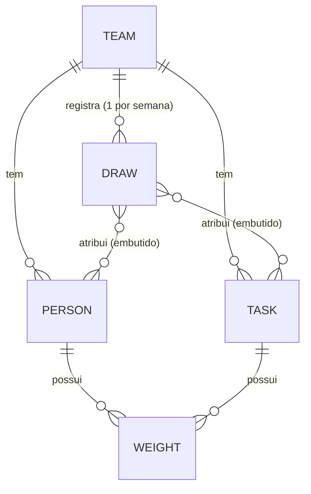

# Modelo de dados e justificativa

Requisitos cobertos: FR-01 a FR-04, FR-16 a FR-18, NFR-02.

## 1. Decisão

**Amazon DynamoDB, uma única tabela (single-table), capacidade provisionada 10 RCU / 10 WCU, classe STANDARD, sem GSI.**

### Por que não SQLite (ou arquivo)

O pedido admite SQLite ou "estrutura simples ou arquivo na AWS". Foram avaliadas as opções abaixo contra o princípio **C-2** (free tier que *não expira*) e contra a necessidade de gravar um sorteio **atomicamente**:

| Opção | Free tier | Atomicidade / concorrência | Veredito |
|---|---|---|---|
| **SQLite em S3** (baixa, altera, sobe) | S3 só é gratuito por **12 meses** (e como crédito em contas novas) | Sem transação; duas execuções simultâneas se sobrescrevem; download+upload a cada run | ✗ viola C-2 |
| **SQLite em EFS** montado na Lambda | EFS gratuito só 12 meses; exige **VPC** (mais recursos, mais custo de rede) | Locks de arquivo sobre NFS são frágeis | ✗ viola C-1 e C-2 |
| **JSON em S3** | idem S3 | Sem transação; sobrescrita total | ✗ |
| **SQLite embutido no pacote** (somente leitura) | grátis | Não grava — o histórico precisa persistir | ✗ |
| **RDS / Aurora** | RDS só 12 meses; Aurora Serverless não é gratuito | transacional | ✗ |
| **DynamoDB provisionado** | **25 GB e 25 RCU/WCU "Always Free"**, sem expiração | `TransactWriteItems` (até 100 itens) + escrita condicional | ✓ |

Pontos que fecharam a decisão:
- **Sempre gratuito** e **sem servidor**: nenhum processo, VPC ou arquivo para gerenciar.
- **`boto3` já vem no runtime** da Lambda ⇒ zero dependência extra (C-1). SQLite também viria no Python, mas não resolve onde persistir.
- **Transação + condição** dão, de graça, os dois comportamentos críticos: *gravar o sorteio inteiro ou nada* (FR-16) e *no máximo um sorteio por time/semana* (FR-17).
- **Volume ínfimo** (dezenas de itens por time, 1 escrita por semana) cabe com folga em 10/10 de 25 unidades gratuitas.
- Observação: **on-demand NÃO entra no free tier**; por isso o modo provisionado. PITR e backups sob demanda também são cobrados ⇒ desligados (backup por exportação — [plan.md §8](plan.md#8-backup-e-recuperação)).

### Por que *single-table* e não várias tabelas

Tudo de um time vive na mesma partição, então **uma `Query`** traz pessoas, tarefas e contadores. Uma tabela só significa um único recurso no CloudFormation e uma única permissão IAM; as transações (sorteio + contadores) também ficam mais simples de raciocinar.

### Por que *não* aninhar tarefas dentro da pessoa (modelo de documento)

O vínculo pessoa↔tarefa é **muitos-para-muitos com atributo** (o contador `h`) e é o dado mais atualizado do sistema. Aninhá-lo num documento da pessoa obrigaria *ler-modificar-gravar* o documento inteiro a cada sorteio e criaria condição de corrida. Modelá-lo como **item próprio (`WEIGHT`)** permite incremento atômico (`ADD`) e é a tradução direta de "toda pessoa que entra tem peso zero para cada tarefa": são N itens criados com `h = 0`.

## 2. Modelo conceitual



`WEIGHT(pessoa, tarefa)` é a entidade associativa: guarda `h`, o **peso histórico**. O peso de sorteio `w = 1/(1+h)` é **derivado** e nunca armazenado (evita inconsistência).

## 3. Layout físico

Tabela com chave `pk` (HASH, String) e `sk` (RANGE, String). IDs são *slugs* `[a-z0-9-]{1,40}`.

| Entidade | `pk` | `sk` | Atributos |
|---|---|---|---|
| **TEAM** | `TEAMS` | `TEAM#<teamId>` | `name`, `whatsapp_group_id`, `timezone` (IANA), `active` (BOOL), `v` |
| **PERSON** | `TEAM#<teamId>` | `PERSON#<personId>` | `name`, `active`, `joined_at` (ISO-8601 UTC), `left_at?`, `v` |
| **TASK** | `TEAM#<teamId>` | `TASK#<taskId>` | `name`, `active`, `v` |
| **WEIGHT** | `TEAM#<teamId>` | `WEIGHT#<taskId>#<personId>` | `cnt` (N, = `h`), `last_week?` (S, ex. `2026-W42`) |
| **DRAW** | `TEAM#<teamId>` | `DRAW#<YYYY-Www>` | ver abaixo |

`v` = versão do esquema (hoje `1`), para migrações futuras.

### Item `DRAW`

```jsonc
{
  "pk": "TEAM#plataforma", "sk": "DRAW#2026-W42",
  "status": "PENDING",            // PENDING | SENT
  "mode": "strict",               // strict | relaxed | fallback
  "min_violations": 0,            // k*
  "attempts": 3,                  // tentativas até aceitar
  "seed": "8123749182734",        // reprodutibilidade (NFR-08)
  "n": 4, "m": 3,
  "created_at": "2026-10-12T12:00:03Z",
  "assignments": [                // lista pequena (m ≤ 99), ordem = ordem das tarefas
    { "task": "ata", "person": "bruno", "p": 0.6316, "w": 1.0, "pool": 1.5833,
      "task_name": "Ata da daily", "person_name": "Bruno" }
  ],
  "justifications": [ { "code": "J1", "person": "ana", "text": "…" } ],
  "send_attempts": 0, "sent_at": null, "wa_message_id": null, "last_error": null
}
```

Nomes são **copiados** para o sorteio (`*_name`) para que a mensagem e o histórico fiquem fiéis mesmo se alguém for renomeado depois.

## 4. Padrões de acesso

| # | Necessidade | Operação | Custo |
|---|---|---|---|
| AP-1 | Listar times ativos | `Query pk = "TEAMS"` | 1 leitura |
| AP-2 | Carregar pessoas, tarefas e contadores do time | `Query pk = TEAM#x AND sk BETWEEN "PERSON#" AND "WEIGHT#~"` | 1 leitura |
| AP-3 | Sorteio **anterior** (para P1) | `Query pk = TEAM#x AND sk BETWEEN "DRAW#" AND "DRAW#<semanaAtual>"` com `ScanIndexForward=false`, `Limit=2`, descartando a semana atual | 1 leitura |
| AP-4 | Sorteio da semana (idempotência) | `GetItem pk = TEAM#x, sk = DRAW#<semana>` | 1 leitura |
| AP-5 | Gravar sorteio + atualizar contadores | `TransactWriteItems` (§5.1) | 1 + m escritas ×2 |
| AP-6 | Marcar envio | `UpdateItem` no `DRAW` | 1 escrita |

Ordenação dos `sk` (alfabética): `DRAW#…` < `PERSON#…` < `TASK#…` < `WEIGHT#…`, e `~` (0x7E) é maior que qualquer caractere de slug — por isso AP-2 exclui os `DRAW` com uma única consulta de faixa. Não há GSI: o conjunto é pequeno e todos os acessos partem da chave do time.

## 5. Transações

### 5.1 Gravar sorteio (AP-5) — `TransactWriteItems`
1. `Put DRAW#<semana>` com `ConditionExpression: attribute_not_exists(pk)` ⇒ **no máximo um sorteio por semana**.
2. Para cada atribuição: `Update WEIGHT#<tarefa>#<pessoa>` com `ADD cnt :1 SET last_week = :semana` (cria o item se faltar ⇒ contador ausente equivale a 0).

Total = `1 + m` itens ⇒ **limite de 99 tarefas por time** (DynamoDB aceita 100 por transação). Se a condição falhar (corrida), nada é gravado e a função lê o `DRAW` vencedor (AP-4).

### 5.2 Reverter sorteio (FR-32) — `TransactWriteItems`
`Delete DRAW#<semana>` com condição de existência + `Update WEIGHT … ADD cnt :-1` com condição `cnt >= :1` em cada atribuição.

### 5.3 Sincronizar cadastro (FR-03/FR-04)
Aplicado como sequência de escritas **idempotentes** (não uma transação única): se falhar no meio, reexecutar completa o restante sem duplicar nem zerar histórico.

- **Pessoa nova**: `Put PERSON` + `Put WEIGHT#<t>#<p> { cnt: 0 }` para cada tarefa ativa/inativa conhecida, todos com `attribute_not_exists` (não sobrescreve histórico).
- **Tarefa nova**: `Put TASK` + `Put WEIGHT { cnt: 0 }` para cada pessoa conhecida.
- **Reentrada** (pessoa inativa que volta): `active = true`, novo `joined_at`, `cnt = 0` em todos os seus `WEIGHT` (regra "entrar no time = peso zero").
- **Ausente do arquivo**: `active = false`, `left_at` preenchido; itens preservados.

## 6. Invariantes de dados

- **D-1** Para toda pessoa e tarefa ativas do time existe `WEIGHT` (leitura trata ausência como `cnt = 0`, de forma defensiva).
- **D-2** `cnt` ≥ 0 sempre.
- **D-3** `DRAW` é imutável após criado, exceto `status`, `send_attempts`, `sent_at`, `wa_message_id`, `last_error`.
- **D-4** `Σ cnt(tarefa t)` = nº de sorteios (não revertidos) em que `t` participou, descontadas reentradas.
- **D-5** `whatsapp_group_id` e nomes não são segredos, mas são dados do time: ficam no banco, **nunca** no git (`data/roster.json` ignorado).

## 7. Capacidade e custo

| Item | Estimativa (time de 8 × 8) | Free tier |
|---|---|---|
| Itens por time | 1 + 8 + 8 + 64 + 52 sorteios/ano ≈ 135 | — |
| Tamanho | ~30 KB/ano/time | 25 GB |
| Leitura por execução | 3 queries + 1 get ≈ 40 KB ⇒ ~10 RCU-unidades | 10 RCU provisionadas (rajada de 300 s cobre) |
| Escrita por execução | transação de 9 itens ≈ 18 WCU-unidades | 10 WCU provisionadas (rajada cobre) |

`boto3` repete automaticamente em caso de *throttling* (modo `standard`). Se algum dia houver muitos times, subir para até 25/25 continua gratuito.
