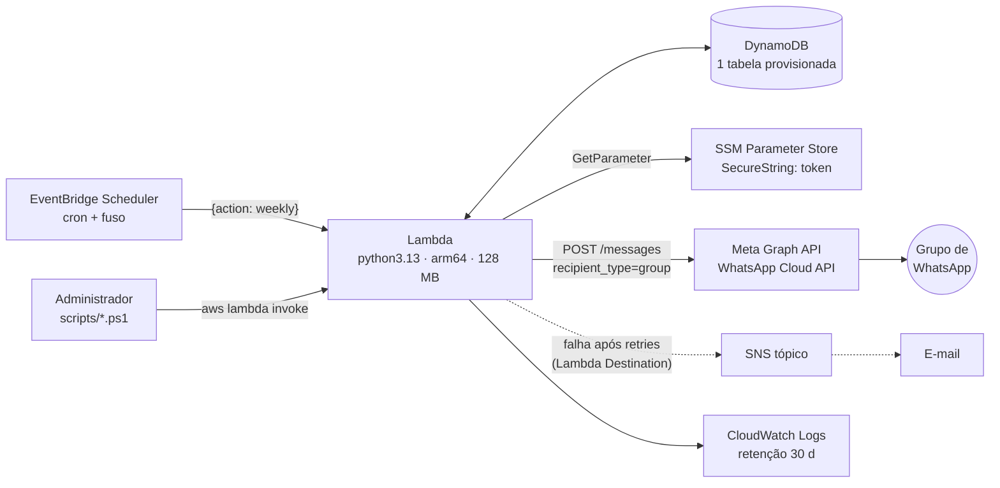

# Plano técnico

Como a [spec](spec.md) será construída. Princípios: [constitution.md](../constitution.md).

## 1. Arquitetura



Uma execução semanal (por time): `Query`×3 + `GetItem` → sorteio em memória → 1 `TransactWriteItems` → 1 `POST` ao Graph API → 1 `UpdateItem`. Sem VPC, sem fila, sem estado fora do DynamoDB.

## 2. Recursos AWS e free tier

Requisito: **tudo** no free tier **sem expiração** (C-2). Estes são os **únicos** tipos de recurso permitidos no template (AC-13).

| Serviço | Recurso no template | Uso previsto | Limite gratuito (Always Free) |
|---|---|---|---|
| **Lambda** | `AWS::Lambda::Function`, `EventInvokeConfig` | ~5 execuções/mês × ~3 s × 0,125 GB ≈ **2 GB-s** | 1 M requisições e 400 000 GB-s por mês |
| **DynamoDB** | `AWS::DynamoDB::Table` (provisionada **10 RCU / 10 WCU**, STANDARD) | KBs de dados | 25 GB, 25 RCU e 25 WCU |
| **EventBridge Scheduler** | `AWS::Scheduler::Schedule` | ~5 disparos/mês | 14 M invocações/mês |
| **SSM Parameter Store** | parâmetro *Standard* `SecureString` (criado pelo deploy, chave `aws/ssm`) | ~5 leituras/mês | parâmetros Standard sem custo |
| **SNS** | `AWS::SNS::Topic`, `Subscription` (e-mail) | ≈ 0 mensagens | 1 M publicações, 1 000 e-mails/mês |
| **CloudWatch Logs** | `AWS::Logs::LogGroup` (30 d) | < 1 MB/mês | 5 GB de ingestão e armazenamento |
| **IAM** | 2 `AWS::IAM::Role` | — | sem custo |
| **CloudFormation** | 1 stack | — | sem custo para recursos AWS nativos |

**Proibidos** (fora do free tier permanente ou com custo oculto): S3 e EFS (gratuitos só 12 meses), RDS/Aurora, Secrets Manager, DynamoDB **on-demand**, PITR e backups do DynamoDB, DynamoDB Standard-IA, KMS com chave gerenciada pelo cliente, VPC/NAT/endpoints, reserved/provisioned concurrency. **Dispensados por simplicidade (C-1), embora tenham free tier:** API Gateway/Function URL (nada precisa de endpoint público), X-Ray, alarmes e dashboards do CloudWatch.

> **Conferência.** Lambda e DynamoDB foram conferidos em 2026-10-10; os demais valores acima vêm de conhecimento prévio e devem ser **revalidados** em [aws.amazon.com/free](https://aws.amazon.com/free/) e nas páginas de preços antes do primeiro deploy. Em contas criadas a partir de 15/07/2025 existe o *Free Plan* com créditos; os serviços *Always Free* continuam disponíveis — também a revalidar. **Custo da Meta** (templates cobrados por destinatário) está **fora** da AWS — ver §10.

## 3. Decisões de arquitetura

| ADR | Decisão | Motivo | Trade-off |
|---|---|---|---|
| 1 | **Python 3.13 só com stdlib** (`urllib`, `random`, `zoneinfo`, `json`) + `boto3` do runtime | Pacote de poucos KB, sem build nem `pip`; `random.Random(semente)` dá reprodutibilidade | Cliente HTTP manual (≈40 linhas) |
| 2 | **DynamoDB single-table** | Ver [data-model.md](data-model.md) | Modelagem por padrões de acesso |
| 3 | **Código fora do CloudFormation**: o template cria a função com um *stub* e `deploy.ps1` publica o zip por `update-function-code` | Dispensa bucket S3 (gratuito só por 12 meses) e `aws cloudformation package` | O código não é gerenciado pela stack. **Nunca** editar `Code.ZipFile` no template, senão a stack sobrescreve o código. Com CI no futuro, trocar por S3 |
| 4 | **Credenciais em `.properties` local → SSM SecureString** | Pedido do projeto; o token não aparece no template, no ambiente da Lambda nem no git (C-3) | 1 chamada ao SSM por execução (cache em memória no *cold start*) |
| 5 | **EventBridge Scheduler** (não *Events rules*) | Fuso IANA nativo (respeita horário de verão), retry configurável | — |
| 6 | **Sem *reserved concurrency*** | Contas novas têm limite baixo de concorrência e não permitem reservar; idempotência vem da **escrita condicional** (`attribute_not_exists`) | Duas execuções simultâneas podem calcular em paralelo; só uma grava, a outra relê |
| 7 | **`src/` plano, só `*.py`** | `Compress-Archive` do PowerShell 5.1 grava `\` em subpastas, quebrando imports na Lambda (Linux) | Sem pacotes Python; módulos soltos |
| 8 | **Alerta por *Lambda Destination (on failure)* → SNS** | O Scheduler chama a Lambda de forma **assíncrona**, então o destino de falha vale; evita alarmes do CloudWatch | Só avisa após esgotar os retries |
| 9 | **Gravar o sorteio *antes* de enviar** | Nunca existe mensagem sem registro; falha de envio vira `PENDING` e é reenviável (FR-23) | Em falha permanente os contadores já avançaram → usar `revert` se o time decidir descartar |
| 10 | **Árvore de soma mantida** apesar de n ≤ 8 | Requisito do modelo ([algoritmo.md §3](algoritmo.md#3-árvore-de-soma)); custo desprezível | Pequena complexidade extra |

## 4. Credenciais e configuração

**Fonte única:** `config/app.properties` (modelo em [config/app.properties.example](../../config/app.properties.example)). O arquivo real está no `.gitignore`.

| Prefixo/chave | Vai para | Quem lê |
|---|---|---|
| `aws.region`, `aws.profile`, `stack.name` | Só os scripts (não chegam à Lambda) | `scripts/*.ps1` |
| `schedule.*`, `alert.email`, `log.retention.days` | Parâmetros do CloudFormation | template |
| `whatsapp.*` (versão, phone id, modo, template) | Parâmetros → variáveis de ambiente da Lambda | `config.py` |
| `draw.max.attempts` | Parâmetro → variável de ambiente | `draw.py` |
| **`secret.*`** | **SSM Parameter Store `SecureString`** em `/<stack>/whatsapp/access-token` | `config.py` (`ssm:GetParameter`, cache em memória) |

Regras:
- O **formato** do arquivo é `chave=valor` por linha; comentários só em linha própria (nada de comentário após o valor).
- O deploy **nunca imprime** valores `secret.*`, nem inclui mensagem de erro com o conteúdo de uma linha do arquivo.
- Para **rotacionar** o token: editar `secret.whatsapp.access.token` e rodar `scripts\deploy.ps1 -SkipInfra -SkipCode`.
- As credenciais da **AWS** usadas pelo deploy ficam no perfil do AWS CLI (`aws configure sso`), **não** no `.properties`.
- Privilégio mínimo em tempo de execução: o *role* da Lambda só acessa a tabela, o prefixo `/<stack>/whatsapp/*` do SSM, o próprio log group e o tópico SNS (ver template).
- O `whatsapp_group_id` e os nomes não são segredos, mas são dados do time: ficam no banco e em `data/roster.json` (ignorado pelo git).

## 5. Estrutura do repositório

```
.
├─ specs/                       ← esta especificação (fonte da verdade)
│  ├─ constitution.md
│  └─ 001-sorteio-semanal/  spec · algoritmo · data-model · plan · tasks · contracts/
├─ infra/template.yaml          ← CloudFormation (toda a infraestrutura)
├─ config/app.properties.example   (app.properties → ignorado)
├─ data/roster.example.json        (roster.json → ignorado)
├─ scripts/                     ← sincronização com a AWS (PowerShell)
│  ├─ common.ps1                   leitura do .properties, wrapper do AWS CLI, invocação da Lambda
│  ├─ deploy.ps1                   stack + segredo no SSM + código da Lambda
│  ├─ sync-roster.ps1              data/roster.json → banco (via ação sync_roster)
│  └─ invoke.ps1                   weekly / resend / revert manuais
├─ src/                         ← Lambda (layout PLANO)
├─ tests/                       ← pytest local (não é empacotado)
└─ build/                       ← zip gerado (ignorado)
```

## 6. Módulos da Lambda

| Módulo | Responsabilidade | Puro? | Requisitos |
|---|---|---|---|
| `index.py` | `handler(event, ctx)`: valida a ação, despacha, isola erros por time, agrega resposta e **lança exceção ao final** se algum time falhou | não | FR-24, FR-31 |
| `config.py` | Lê variáveis de ambiente; obtém o token do SSM sob demanda (cache de módulo) | não | NFR-03 |
| `sumtree.py` | `SumTree`: `build`, `set`, `total`, `sample`, `peso` | **sim** | FR-11 |
| `solver.py` | `k*` e atribuição ótima por **fluxo de custo mínimo** (SPFA), n,m ≤ ~50. Limite inferior de carga via aresta dupla: `pessoa→destino` = (cap `Lmin`, custo `−BIG`) + (cap `Lmax−Lmin`, custo 0), `BIG > m`; violações = arestas `prev` usadas | **sim** | FR-13, FR-15 |
| `draw.py` | `sortear()` conforme [algoritmo.md §6](algoritmo.md#6-procedimento-do-sorteio-atômico); `validar()` | **sim** | FR-10 a FR-15 |
| `message.py` | `justificar()` (J1–J4), `renderizar()` texto e compacto, divisão em partes | **sim** | FR-20, FR-21 |
| `store.py` | Todo o acesso ao DynamoDB: AP-1…AP-6, `commit_draw`, `revert_draw` | não | FR-16, FR-17 |
| `whatsapp.py` | `send()` via `urllib.request`; modo `auto`; classificação de erros; backoff | não | FR-22, FR-23 |
| `roster.py` | `validar(roster)`, `planejar(atual, desejado)` (puro) e `aplicar(plano)` (I/O) | parcial | FR-03, FR-04 |

Regra de dependência: módulos **puros** não importam `boto3`, `urllib` nem `os.environ`. `index.py` é o único que conhece todos.

### Estratégia de testes (`tests/`, pytest, sem dependências extras)

| Camada | O que testa | Cobre |
|---|---|---|
| Unitário `sumtree` | fronteiras de `sample`, `set(i,0)`, soma | INV-7, INV-9 |
| Propriedades `draw`/`solver` | milhares de instâncias aleatórias com semente fixa; `k*` contra força bruta para n,m ≤ 6 | INV-1 a INV-6, AC-01/02/03/06/07 |
| Estatístico `draw` | frequência empírica ≈ `w/Σw` | INV-8, AC-04 |
| *Golden files* `message` | texto exato dos exemplos de [contracts/whatsapp.md](contracts/whatsapp.md) | AC-04, FR-21 |
| `store` com *fake* em memória | transação tudo-ou-nada, idempotência, reversão | AC-08, AC-10 |
| `whatsapp` com servidor HTTP local | mapeamento de erros, fallback `auto` | AC-09 |
| Estático do template | tipos de recurso ⊆ lista permitida (§2) e ausência de `secret` | AC-12, AC-13 |

## 7. Deploy e sincronização com a AWS

`scripts\deploy.ps1` (idempotente), na ordem:

1. Lê `config/app.properties`; valida chaves obrigatórias; confere credenciais (`sts get-caller-identity`).
2. `aws cloudformation deploy` com [infra/template.yaml](../../infra/template.yaml) (`CAPABILITY_IAM`, tag `project=whatsapp-team-draw`). Cria tabela, log group, IAM, Lambda *stub*, SNS, Scheduler.
3. Lê as *outputs* da stack e grava `secret.whatsapp.access.token` no SSM (`SecureString`, `--overwrite`).
4. Empacota `src/*.py` em `build/lambda.zip` e publica com `aws lambda update-function-code` + `wait function-updated`.

Depois: confirmar o e-mail do SNS → `scripts\sync-roster.ps1 -DryRun` → `scripts\sync-roster.ps1` → `scripts\invoke.ps1 -Action weekly -DryRun`.

Pré-requisitos locais: AWS CLI v2, Windows PowerShell 5.1+ (ou 7+), Python 3.13 (só para os testes).
Remoção: `aws cloudformation delete-stack` apaga tudo **exceto** a tabela (política `Retain`) e o parâmetro SSM; apagá-los manualmente se for descartar os dados.

## 8. Backup e recuperação

PITR e backups sob demanda do DynamoDB têm custo ⇒ desligados. O volume é pequeno; exportar periodicamente:

```powershell
aws dynamodb scan --table-name <TableName> --output json > backup-$(Get-Date -f yyyyMMdd).json
```
(`TableName` está nas *outputs* da stack; **não** versionar o arquivo — contém nomes.) Como o estado é reconstruível a partir de `roster.json` + histórico exportado, a recuperação é recriar a stack e reimportar.

## 9. Observabilidade e operação

- Logs JSON nativos (`LoggingConfig`); campos: `team`, `week`, `action`, `status`, `mode`, `attempts`, `duration_ms`. **Sem nomes de pessoas e sem token.**
- Falha → 2 retries da Lambda → SNS → e-mail. Diagnóstico: CloudWatch Logs `/aws/lambda/<stack>-draw`.
- *Runbook* resumido:
  - **Sorteio gravado, mensagem não saiu** → corrigir a causa (token/template) → `invoke.ps1 -Action resend -Team … -Week …`.
  - **Time quer descartar o sorteio** → `invoke.ps1 -Action revert -Team …` → `invoke.ps1 -Action weekly -Team …`.
  - **Pessoa entrou/saiu** → editar `data/roster.json` → `sync-roster.ps1`.
  - **Pausar** → `schedule.state=DISABLED` + `deploy.ps1 -SkipSecrets -SkipCode`.

## 10. Custos e dependências fora da AWS

| Item | Observação |
|---|---|
| Meta WhatsApp | Mensagens **não-template** são gratuitas; **templates** são cobrados por mensagem entregue × nº de membros do grupo quando fora da janela de atendimento. Preço varia por país/categoria; consultar a tabela vigente. |
| Elegibilidade | Groups API exige OBA e número fora do app WhatsApp Business — ver [spec.md §9](spec.md#9-restrições-externas--whatsapp-meta). |
| Domínio/número | Número de telefone dedicado à Cloud API. |
